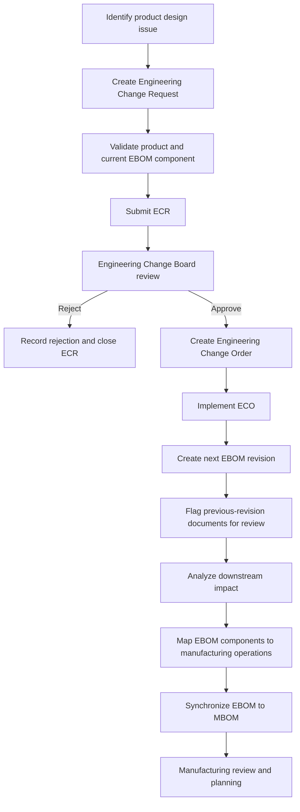
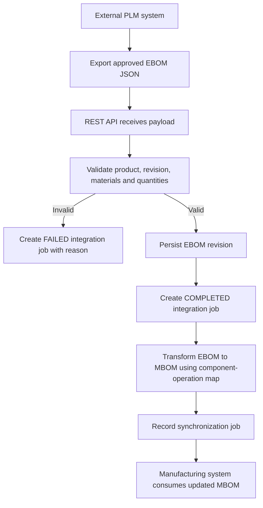

# Business Process Flow

## A. Internal engineering change process

## B. External PLM system integration process

## C. Product data lifecycle

Engineering creates the product definition and EBOM. Controlled changes are requested and approved through ECR/ECO. The approved revision is implemented and mapped into a manufacturing-specific BOM. Documents and downstream orders are reviewed before manufacturing adopts the new version.

## D. Important process distinction

EBOM and MBOM serve related but different purposes. EBOM represents the engineering design structure. MBOM represents how the product is planned/assembled/manufactured, and can group or sequence components to manufacturing operations. This demo uses a one-to-one component transformation with an operation mapping table to keep the logic understandable; real implementations can require more complex transformation rules.
